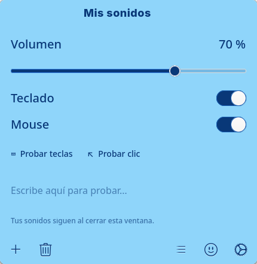
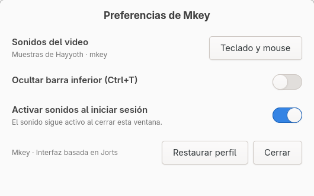

# Mkey

Sonidos de teclado y mouse para Linux, con una interfaz de notas adhesivas basada
en [Jorts](https://codeberg.org/elly-code/jorts). El servicio de audio y la interfaz
están escritos en C11.



- Volumen en tiempo real y controles independientes para teclado y mouse.
- Sonidos distintos para teclas, espacio, Enter y pulsación/liberación del mouse.
- Perfiles con título editable, emojis y restauración del último perfil eliminado.
- Once colores, tamaño de texto y tipografía monoespaciada.
- Audio independiente de la ventana e inicio de sesión mediante systemd.
- Entrada mediante evdev y audio mediante PulseAudio, compatible con PipeWire.

## Compilar

Dependencias: compilador C11, Make, pkg-config, GLib, GTK 4.12 o posterior y
libpulse-simple. No hay un intérprete en tiempo de ejecución.

Fedora:

```sh
sudo dnf install gcc make pkgconf-pkg-config gtk4-devel glib2-devel pulseaudio-libs-devel
```

Debian/Ubuntu:

```sh
sudo apt install build-essential pkg-config libgtk-4-dev libglib2.0-dev libpulse-dev
```

```sh
make -j2
make test
```

## Instalar para tu usuario

```sh
make install
systemctl --user daemon-reload
systemctl --user enable --now mkey.service
```

Abre **Mkey** desde el menú de aplicaciones o ejecuta `~/.local/bin/mkey-gui`.
Por defecto se instala en `~/.local`; `PREFIX` y `DESTDIR` permiten cambiar o
preparar el destino de instalación.

El servicio necesita acceso de lectura a los dispositivos de entrada de la sesión.
Si el registro no muestra tu teclado y mouse, instala la regla opcional
`data/70-mkey-input.rules` en `/etc/udev/rules.d/`, recarga udev y vuelve a iniciar
sesión. Esta regla concede acceso a la persona que tiene la sesión local activa.

```sh
journalctl --user -u mkey.service
systemctl --user stop mkey.service
```

Cerrar la interfaz deja el audio funcionando. Para desactivar su arranque
automático, usa Preferencias o `systemctl --user disable mkey.service`.

## Usar la interfaz

La barra inferior permite crear, eliminar y elegir perfiles, añadir un emoji al
título y abrir la apariencia. Los cambios se guardan automáticamente. El título
se edita directamente y el campo de prueba no se guarda.

| Atajo | Acción |
| --- | --- |
| Ctrl+N | Crear perfil |
| Ctrl+W | Cerrar interfaz |
| Ctrl+O / Ctrl+G | Abrir apariencia |
| Ctrl+L | Enfocar título |
| Ctrl+T | Mostrar u ocultar barra inferior |



## Desarrollo

```sh
make test           # Configuración, mezcla, saturación, muestras y eventos
make test-ui        # Prueba GTK; usa una configuración temporal
make format         # clang-format 23.1.3
make format-check
```

En un entorno sin pantalla: `dbus-run-session -- xvfb-run -a make test-ui`.
Las pruebas de interfaz deben ejecutarse sin otra ventana de Mkey abierta.

La estructura y las decisiones de implementación están en
[docs/architecture.md](docs/architecture.md). Las reglas de contribución están en
[CONTRIBUTING.md](CONTRIBUTING.md). GitHub Actions compila, verifica el formato,
ejecuta las pruebas y comprueba una instalación en un directorio temporal.

## Configuración y sonidos

La configuración respeta `XDG_CONFIG_HOME` y los datos `XDG_DATA_HOME`:

```text
~/.config/mkey/
  settings           Volumen, dispositivos y solicitudes de prueba
  interface.ini      Título y apariencia de la ventana
  profiles-v2/       Perfiles guardados
  deleted-profile.ini

~/.local/share/mkey/
  style.css
  sounds/*.pcm
```

`MKEY_DATA_DIR` permite ejecutar desde el código fuente:

```sh
MKEY_DATA_DIR="$PWD/data" build/mkey-gui
build/mkey "$PWD/data/sounds"
```

Las muestras son PCM mono de 48 kHz, enteros de 16 bits en orden little endian.
Se mezclan hasta 64 voces con saturación a 16 bits. Los eventos de teclado y
mouse no se registran ni se transmiten por red.

## Licencia y créditos

Código bajo GPL-3.0-or-later. La interfaz adapta Jorts; las muestras de referencia
provienen de un video de Hayyoth y tienen una procedencia y condiciones separadas.
Consulta [THIRD_PARTY.md](THIRD_PARTY.md) y [LICENSE](LICENSE).
